# GroundGate architecture and flows

How the pieces fit, what runs where, and what happens on every path, good and bad. Every diagram below is Mermaid (renders on GitHub). Pre-rendered PNGs of the main ones are at the bottom for viewers that do not render Mermaid.

**Contents**
[1 Design principles](#1-design-principles) · [2 System context and trust boundaries](#2-system-context-and-trust-boundaries) · [3 Components](#3-components) · [4 Request lifecycle](#4-request-lifecycle) · [5 Typed actions and premises](#5-typed-actions-and-premises) · [6 Evidence cascade](#6-evidence-cascade) · [7 Verdict to decision](#7-verdict-to-decision) · [8 The action token](#8-the-action-token) · [9 Protected executor](#9-protected-executor) · [10 Failure flows](#10-failure-flows) · [11 Process isolation](#11-process-isolation) · [12 Agent integration (LangGraph)](#12-agent-integration-langgraph) · [13 Evaluation architecture](#13-evaluation-architecture) · [14 What the architecture does not do](#14-what-the-architecture-does-not-do) · [15 Rendered images](#15-rendered-images)

---

## 1 Design principles

| Principle | What it means in the code |
|---|---|
| **The agent is untrusted** | It sends JSON. It never holds the HMAC key, a token, the verifier connection or a write handle. Its free-text explanation is never evidence. |
| **Facts, not permissions** | The gate derives the *premises* of a call (order exists, belongs to this customer, status allows it, amount fits) from the tool schema, then checks them against a record. |
| **Absence is not contradiction** | A missing cache entry or an unreachable source is `UNVERIFIABLE`, never `CONTRADICTED`. Only evidence that disagrees contradicts. |
| **Pay for certainty by risk** | Cache first; at most one authoritative lookup, and only when the action's risk calls for it. High-risk actions need authoritative support. |
| **A verdict expires** | The executor re-derives and re-checks every premise inside the write transaction, so a change after the check cannot commit. |
| **Fail closed** | Verifier fault, audit failure, service timeout, malformed request, expired or replayed token: nothing executes. |

## 2 System context and trust boundaries

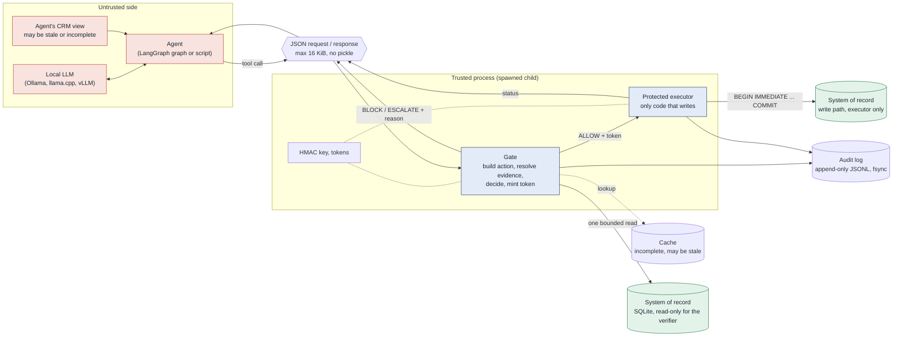

**Out of scope:** an attacker with the same OS user can ptrace the child or open the database file. Closing that needs OS-level separation (distinct uid or container). See [`THREAT_MODEL.md`](THREAT_MODEL.md).

## 3 Components

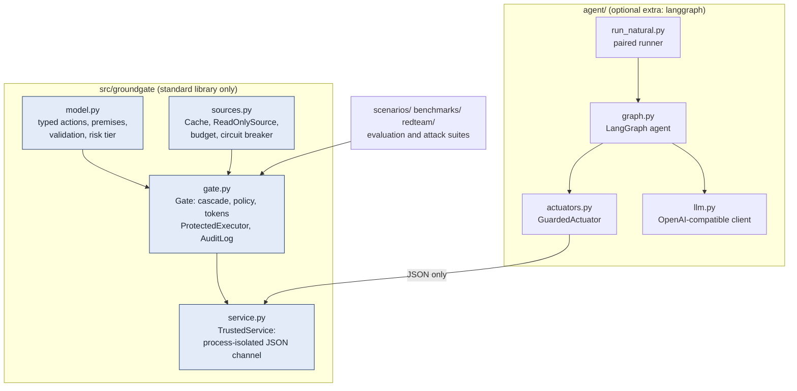

| File | Responsibility |
|---|---|
| `src/groundgate/model.py` | tool table, premise predicates, `build_ir` (validation and risk), `rederive_ir` |
| `src/groundgate/sources.py` | `Cache` (freshness by TTL), `ReadOnlySource` (SQLite `mode=ro`, lookup budget, breaker) |
| `src/groundgate/gate.py` | `Gate.evaluate/run`, `ProtectedExecutor.run`, `AuditLog`, token mint and verify, `init_db` |
| `src/groundgate/service.py` | `TrustedService` child process and the agent-facing `submit()` |
| `agent/` | LangGraph agent, local-model client, 40 tickets, paired natural-error runner |

The core never imports `agent/`. The only way the agent reaches the gate is `TrustedService.submit()`.

## 4 Request lifecycle

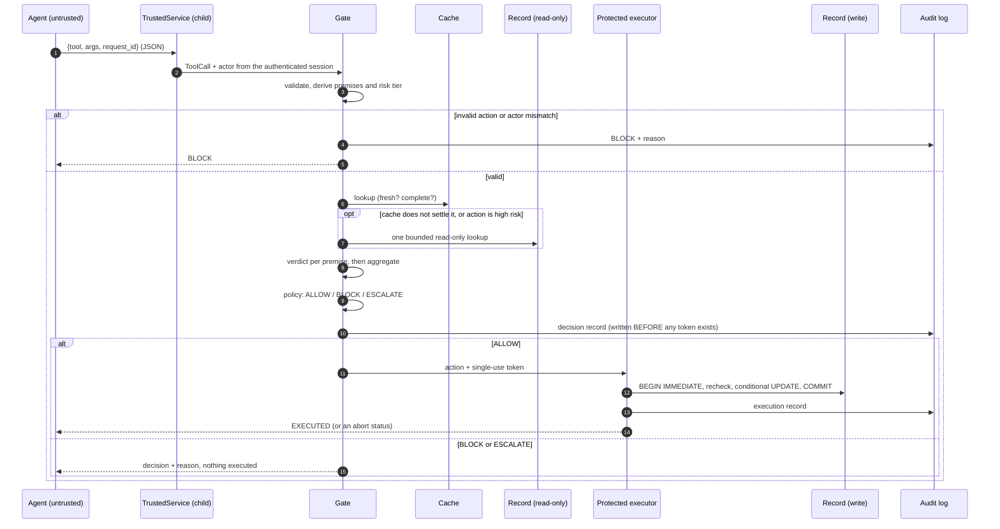

## 5 Typed actions and premises

The gate does not read the agent's explanation. It builds a typed action from `(tool, args, request_id)` and derives the premises itself.

| Tool | Reversible | Premises | Notes |
|---|---|---|---|
| `refund_order(order_id, customer_id, amount_cents)` | no | `exists`, `owner`, `refundable_status` (delivered), `amount_within_remaining` | risk is **high** when `amount_cents >= HIGH_AMOUNT_CENTS` (5000) |
| `cancel_order(order_id, customer_id)` | no | `exists`, `owner`, `cancellable_status` (placed or paid) | no amount, so always **high** |
| `update_address(order_id, customer_id, address)` | yes | `exists`, `owner`, `cancellable_status` | reversible, so low risk |

Premises that depend on `exists` inherit `CONTRADICTED` from it.

**Validation (any failure is an immediate BLOCK, before any evidence is read):** exact argument set and types (a bool is not an int); `order_id` matches `ORD-dddd`; amount in `(0, 10^9]`; `customer_id` format; address at most 200 characters with no control characters; `request_id` at most 128 characters; and, when the service has an authenticated actor, `customer_id` must equal it. A client-supplied actor field is ignored.

## 6 Evidence cascade

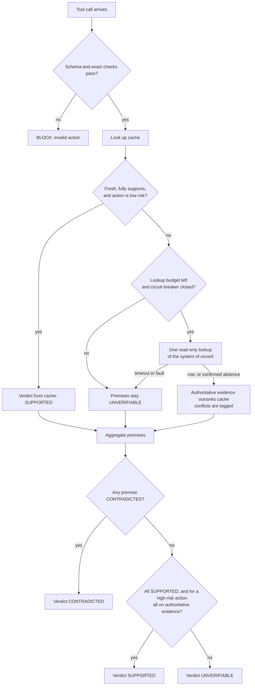

**Resolution rules**

* Authoritative evidence beats cache. A fresh cache entry is used only when no authoritative reading exists. A **stale** cache entry supports nothing.
* When both exist and disagree on a premise, authoritative wins and the premise is recorded under `conflicts` in the audit trace.
* A confirmed absence from the system of record is `CONTRADICTED` for `exists`. A cache *miss* is `UNVERIFIABLE`.
* A cache row missing a needed field (incomplete entry) leaves that premise unresolved.
* An optional LLM tier for natural-language policy claims may only **downgrade** a verdict; it never upgrades one and never overrides a contradiction. It is off by default.

**Premise verdict states**

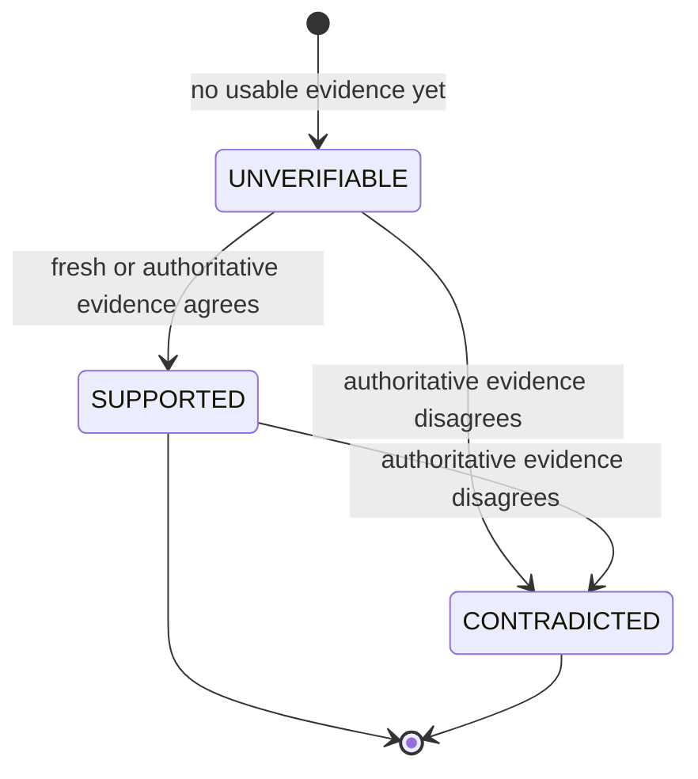

**Lookup budget and circuit breaker** (inside `ReadOnlySource`)

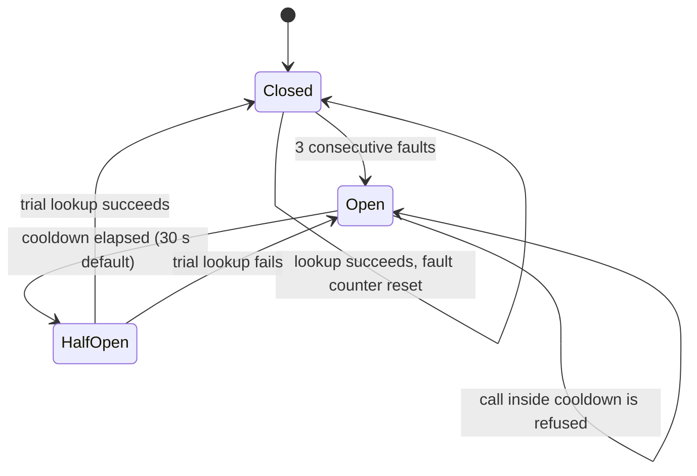
Refused or failed lookups leave premises `UNVERIFIABLE`; they are never read as "checked, fine". An optional per-action lookup budget raises `BudgetExhausted` the same way.

## 7 Verdict to decision

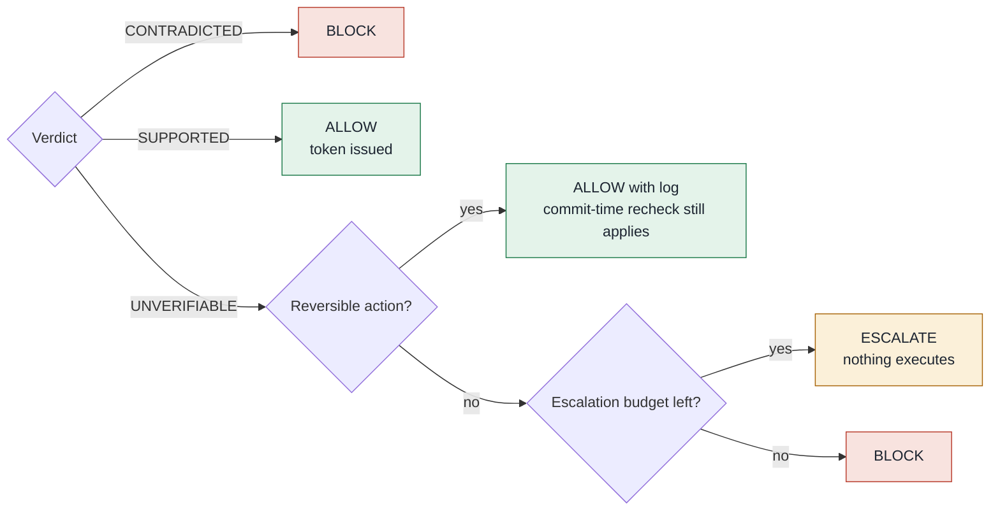

| Verdict | Irreversible or high value | Reversible and low value |
|---|---|---|
| **CONTRADICTED** | BLOCK | BLOCK |
| **SUPPORTED** | ALLOW | ALLOW |
| **UNVERIFIABLE** | ESCALATE (BLOCK once the escalation budget is spent) | ALLOW and log |

The costs behind this table (harm 50, false block 1, escalation 5, lookup 0.1) are assumptions, not calibrated values. `ESCALATE` is a verdict today, not a workflow: there is no escalation consumer yet.

## 8 The action token

On ALLOW the gate writes its audit record first, then mints a token. No audit record, no token.

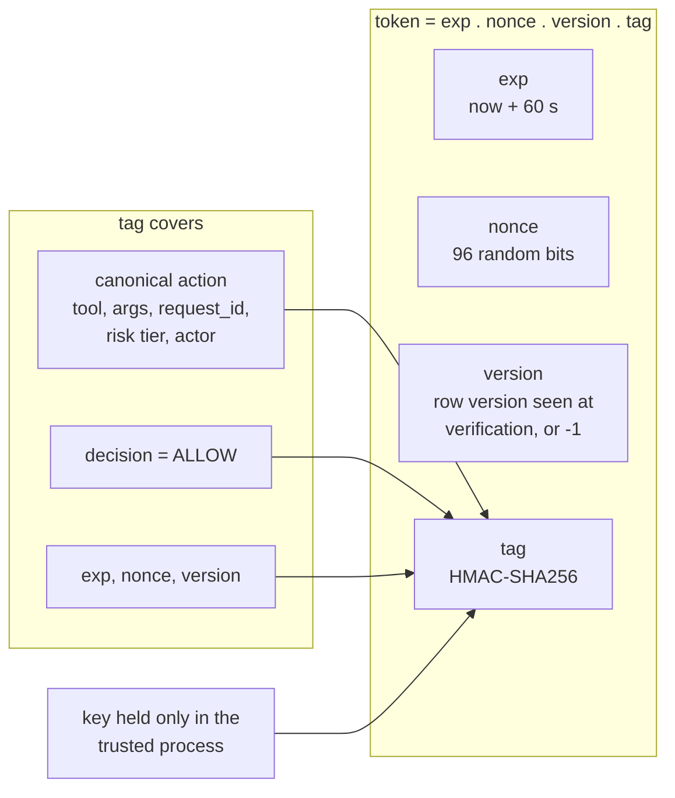

| Property | Enforced by |
|---|---|
| Bound to the exact action | the tag covers the canonical action, recomputed from live fields at verification; edited arguments break it |
| Expires | `exp`, 60 s |
| Single use | the nonce is inserted into `used_tokens` in the same transaction as the write |
| Not forgeable by the agent | the key never leaves the child process; comparison is constant-time |
| Scoped to the principal | the actor is part of the canonical action and of the idempotency key |

## 9 Protected executor

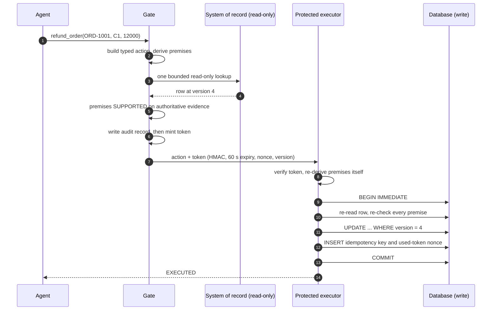

**Check order inside the transaction**

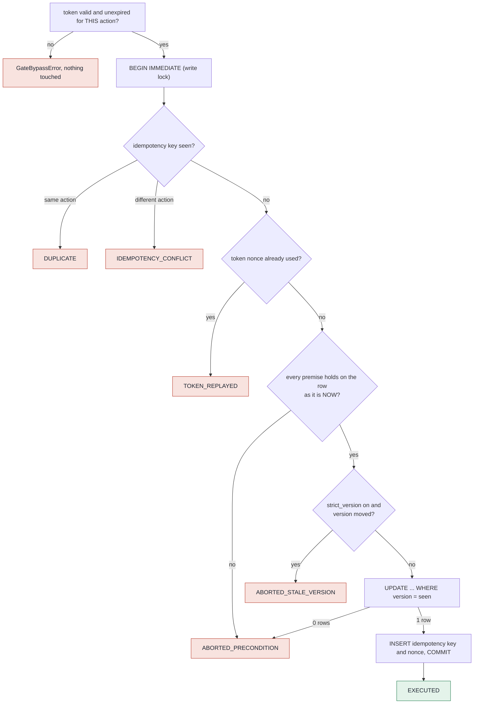

**Least privilege inside the executor.** Its SQLite connection installs an authorizer that allows only `SELECT`, `INSERT` into `idem` and `used_tokens`, and `UPDATE` of `orders.refunded_cents`, `status`, `address`, `version`. Any other statement is denied, so even a bug in the executor cannot, say, delete rows.

**Data model**

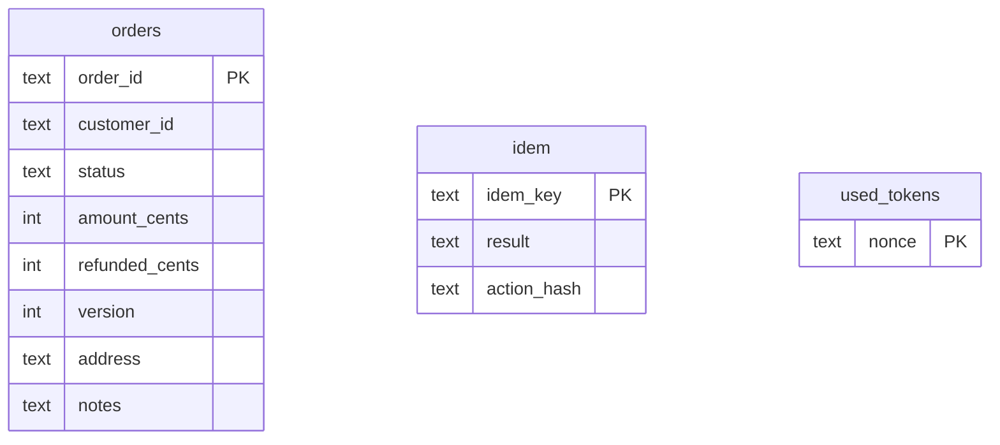
The three tables have no foreign keys. `idem` and `used_tokens` are written in the same transaction as the `orders` update, which is what ties them together.

| `ExecResult.status` | Meaning |
|---|---|
| `EXECUTED` | committed once |
| `DUPLICATE` | same idempotency key and same action: a retry, not a second write |
| `IDEMPOTENCY_CONFLICT` | `request_id` reused for a different action |
| `TOKEN_REPLAYED` | nonce already consumed |
| `ABORTED_PRECONDITION` | a premise failed on the live row, or the version-conditional update matched nothing |
| `ABORTED_STALE_VERSION` | (optional `strict_version`) the row moved since verification |
| `ERROR` | unexpected exception, rolled back |

## 10 Failure flows

| # | Situation | What happens | Result |
|---|---|---|---|
| 1 | Evidence is stale | a stale entry supports nothing; the gate falls through to the authoritative lookup; a high-risk action never rests on cache | allowed if the source agrees, else blocked |
| 2 | Authoritative source times out | premises stay `UNVERIFIABLE`; irreversible: ESCALATE (BLOCK after the budget); reversible: allow with a log | nothing irreversible runs on an unanswered question |
| 3 | Record changes after verification | executor re-reads inside `BEGIN IMMEDIATE`, re-checks, version-conditional UPDATE | `ABORTED_PRECONDITION`, nothing written |
| 4 | Token or request reused | nonce in `used_tokens`; idempotency key per actor | `TOKEN_REPLAYED` / `DUPLICATE` / `IDEMPOTENCY_CONFLICT` |
| 5 | Forged or stripped token, fake ALLOW | key lives only in the child; service ignores extra fields | BLOCK or `GateBypassError` |
| 6 | Audit write fails | no record, no token | BLOCK (fail closed) |
| 7 | Verifier raises | caught at `evaluate` | BLOCK (fail closed) |
| 8 | Service dead, slow or sent garbage | `submit()` times out or the child returns BLOCK | BLOCK (fail closed) |
| 9 | External API succeeds but the local commit fails | a local transaction cannot be atomic with an external call | **not solved here**; simulated mitigations in `benchmarks/external_effects.py` |

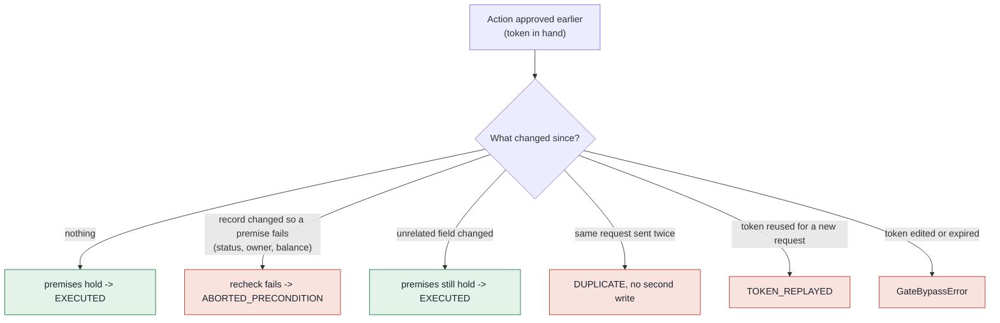

## 11 Process isolation

| Lives in the trusted child | Lives on the agent side |
|---|---|
| HMAC key, every token | a JSON request and a JSON response |
| verifier (read-only) connection | the model, the prompt, the CRM view |
| executor (write) connection | no key, no token, no database handle |
| audit log handle | |

Only JSON crosses the pipe (never pickle). Requests over 16 KiB are refused by `submit()`; an oversized raw frame makes the pipe unreadable and the service exits, which fails closed (a denial of service, but nothing executes). Any key in a request other than `tool`, `args`, `request_id` (token, premises, decision, idempotency key) is ignored by construction.

## 12 Agent integration (LangGraph)

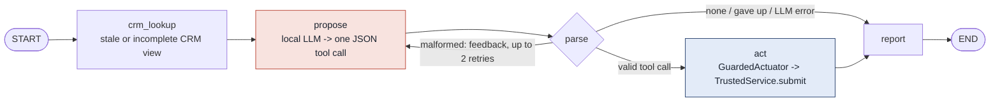

The only path to a write is `parse -> act`. Parse failures, an empty proposal and an unreachable model all go straight to `report`, so nothing executes.

**Paired natural-error run** (`agent/run_natural.py`): one model proposal per (ticket, run) is judged four ways on identical state.

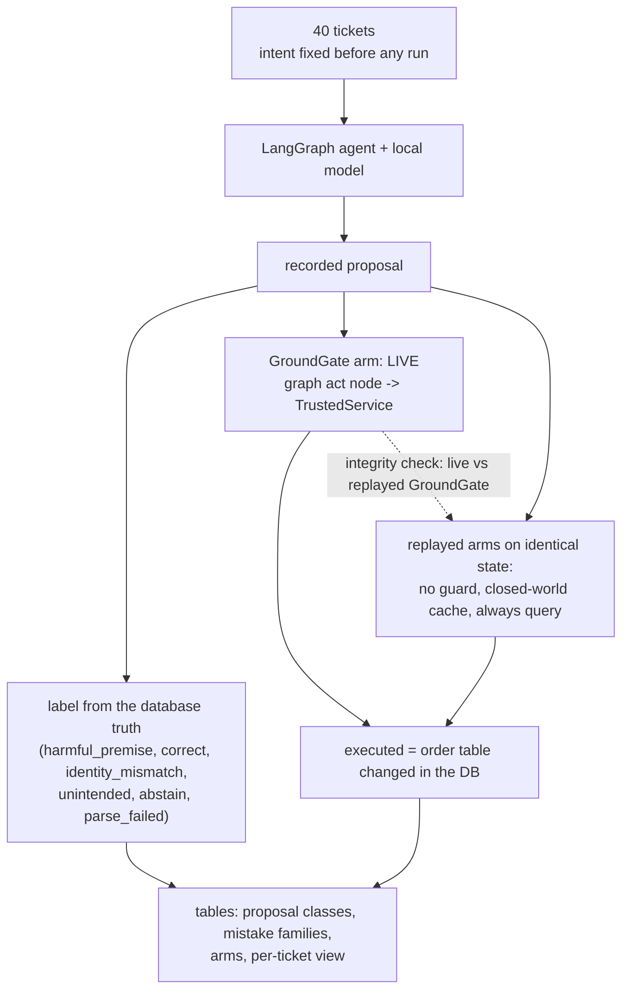

Status: harness built and tested with a scripted stand-in and a fake endpoint; **not yet run on a real model**. See [`../agent/README.md`](../agent/README.md).

## 13 Evaluation architecture

Four state views are kept apart so a decision made on one view and executed against another can be measured.

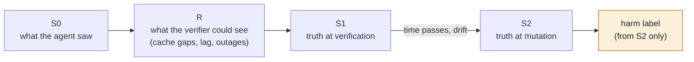

**Scenario runner pipeline (anti-circularity)**

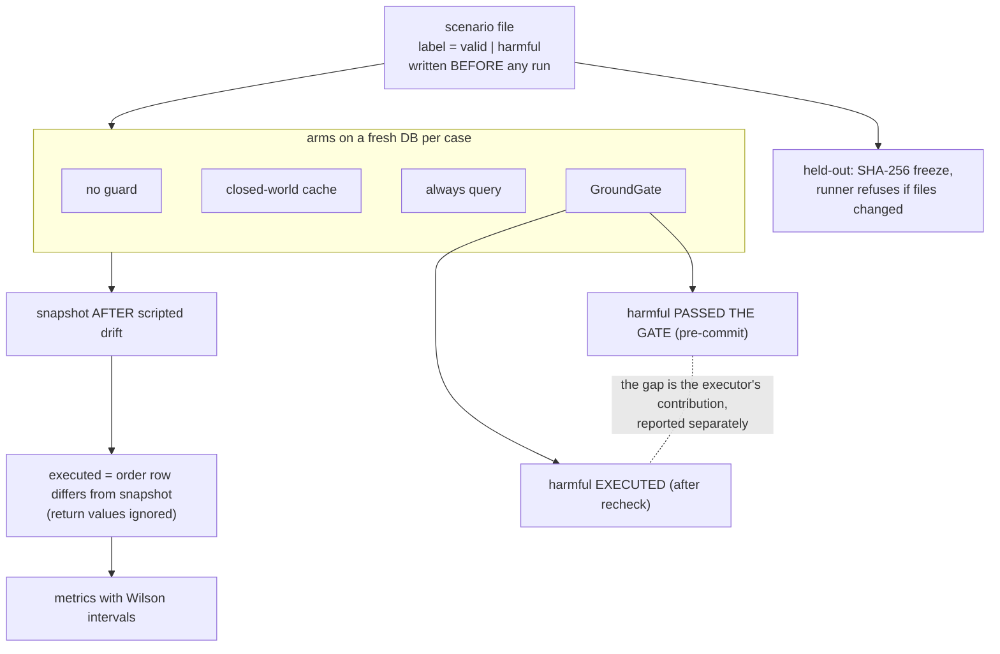

## 14 What the architecture does not do

* **Fresh-but-wrong cache on a low-value action passes the gate** (dev `S03`, held-out `H032`, `H041`, red-team X09). The executor's recheck catches it, not the gate.
* **A valid but unintended action by the right customer executes** (X38). No fact check can object to it.
* **Late-change protection comes from the executor recheck**, which any system with an atomic recheck can have. It is not credited to the gate's routing.
* **Not built:** escalation consumer, tamper-evident (hash-chained) audit log (it is append-only JSONL), key rotation, OS-level separation of the trusted process, outbox for external effects.
* **One domain:** three order tools on SQLite.

## 15 Rendered images

Pre-rendered from the same sources in [`diagrams/`](diagrams/). The roadmap image predates the latest plan; the Mermaid roadmap in the README is current.

<b>Architecture</b>

<b>Verdict to decision</b>

<b>Commit sequence</b>

<b>Evaluation framework (four state views)</b>

<b>Evidence cascade (tall)</b>

<b>Original detailed architecture (all 11 nodes)</b>

Predates the external-effects model and does not draw it.

