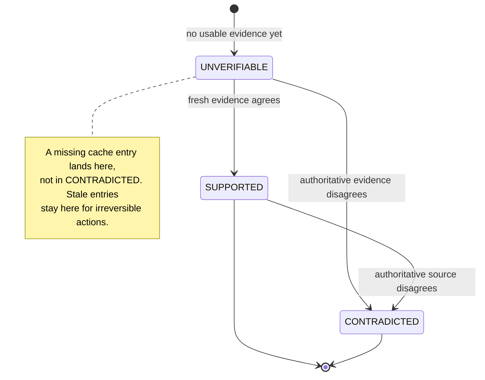
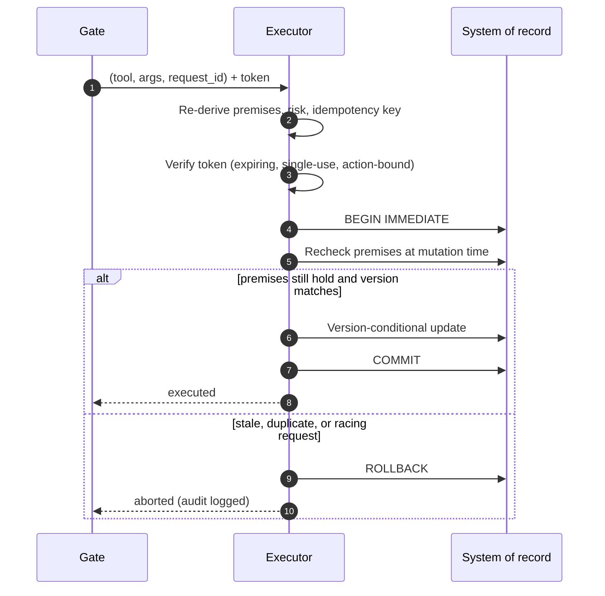
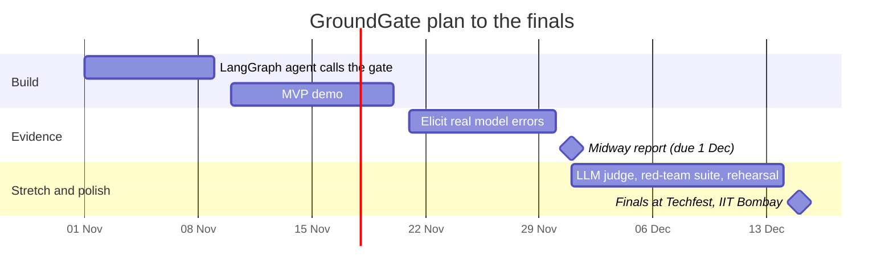

<div align="center">

# GroundGate

### Check an agent's facts before it acts.

**Perceptron Hackathon 2026** · IITB-Optiver AI Innovation Lab · Techfest, IIT Bombay
**Round 1 submission** · Theme 6 (AI You Can Actually Trust) · Problem 9


-orange)


[Abstract (PDF)](assets/GroundGate_Abstract.pdf) · [The problem](#-the-problem) · [Architecture](#-architecture) · [Evaluation](#-evaluation) · [Roadmap](#-roadmap) · [Round 1 checklist](#-round-1-checklist)


</div>

---

## 📌 TL;DR

Most agent guardrails ask **"is the agent allowed to do this?"** GroundGate asks **"is what the agent believes actually true?"**

It sits between an LLM agent and its mutating tools (refund, cancel, change address). Before any call runs, it checks the call's premises against a system of record, pays for authoritative lookups only when they are worth it, and re-checks at commit time inside the executor so a stale verdict cannot be acted on.

| | |
|---|---|
| **Problem** | Problem 9, *Catching an Agent Before It Acts on a Bad Idea* |
| **Core idea** | Three-valued verdicts (SUPPORTED / CONTRADICTED / UNVERIFIABLE) plus a budgeted verification cascade plus a commit-time recheck |
| **Stack** | Python standard library gate · SQLite system of record · LangGraph agent (planned) |
| **Needs** | No paid APIs, no GPU for the core |
| **Honest caveat** | All benchmark numbers come from synthetic worlds, not real model errors |

---

## 🚦 Status

<details open>
<summary><b>What is built, and what is not (click to collapse)</b></summary>

| Component | Status |
|---|---|
| Typed action record and premise extraction | ✅ Built, tested |
| Evidence resolution (source, authority, freshness) | ✅ Built, tested |
| Verification cascade (exact, cache, one budgeted lookup) | ✅ Built, tested |
| Risk-table policy (block / escalate / allow) | ✅ Built, tested |
| Execution barrier (token, idempotency, `BEGIN IMMEDIATE` recheck) | ✅ Built, tested |
| Synthetic evaluation harness (20 worlds × 500 actions × 8 conditions) | ✅ Built |
| Automated tests: unit, security, multi-process race, benchmark integrity | ✅ 81 passing |
| LangGraph agent calling the gate | 🔜 Planned (by 9 Nov) |
| Real-LLM run on about 120 constructed scenarios | 🔜 Planned |
| LLM-judge tier for UNVERIFIABLE high-risk calls | 🔜 Planned (stretch) |
| Red-team suite, 60 to 100 cases | 🔜 Planned (stretch) |
| Executor view that lags the system of record | 🔜 Planned |

</details>

> **Repository note.** This repository currently holds the Round 1 submission material (abstract and diagrams). The prototype source and benchmark scripts are not in it yet.

---

## 🎯 The problem

The costliest agent error is often a **permitted, well-formed call resting on a false fact**: a refund for an order that does not exist, belongs to another customer, or was already refunded. Nothing errors, so nothing flags it.


Permission layers such as AgentSpec, Progent and CaMeL decide whether the agent may act. They do not check whether its facts are true. That is the gap GroundGate targets.

---

## 🧩 Why it is hard

<details>
<summary><b>1. Absence is not contradiction</b></summary>

A cache that lacks an order has not shown the order is fake. If the guard blocks on absence, it produces false blocks. If it trusts stale entries, it produces wrong executions. GroundGate therefore keeps **UNVERIFIABLE** separate from **CONTRADICTED**.

</details>

<details>
<summary><b>2. Verification costs something</b></summary>

Each authoritative lookup adds latency and spends budget. The guard has to decide when a lookup is worth paying for, which is why GroundGate counts lookups per action and caps them.

</details>

<details>
<summary><b>3. Verdicts go stale</b></summary>

State can change between the check and the write. Retries and concurrent requests must not act twice. GroundGate rechecks inside the executor, in the same transaction as the write.

</details>

---

## 🏗 Architecture

> Trust boundary: the agent's output is untrusted. Only the executor and the system of record are trusted. Same-OS-privilege attackers are out of scope.

```mermaid
flowchart LR
    A["Agent<br/>(untrusted, LangGraph planned)"] --> R1
    subgraph TRUSTED["Trusted side"]
        direction LR
        R1["1. Typed action record<br/>args, reversibility, amount,<br/>idempotency key, premises"] --> R2
        R2["2. Evidence resolution<br/>source, authority, freshness<br/>free text is never evidence"] --> R3
        R3["3. Verification cascade<br/>exact checks, then cache,<br/>then at most 1 lookup"] --> R4
        R4{"4. Risk-table policy"}
        ES[("Evidence sources<br/>cache (incomplete, stale)<br/>SQLite system of record")] -. lookup .-> R3
        R4 -- CONTRADICTED --> BLK["BLOCK"]
        R4 -- UNVERIFIABLE --> ESC["ESCALATE or LOG"]
        R4 -- SUPPORTED --> TOK["Action-bound token<br/>expiring, single-use"]
        ESC -. "low risk: allow + log" .-> TOK
        TOK --> R5["5. Execution barrier<br/>re-derive, recheck,<br/>version-conditional update"]
    end
    R5 --> H["Evaluation harness<br/>20 worlds x 500 actions x 8 conditions"]

    classDef untrusted fill:#f8d7d3,stroke:#1f3a5f,color:#000;
    classDef gate fill:#dde8f6,stroke:#1f3a5f,color:#000;
    classDef policy fill:#fff0d3,stroke:#1f3a5f,color:#000;
    classDef exec fill:#e3dff2,stroke:#1f3a5f,color:#000;
    classDef bad fill:#f5dcd6,stroke:#a33,color:#000;
    class A untrusted
    class R1,R2,R3 gate
    class R4,ESC,TOK policy
    class R5 exec
    class BLK bad
```



### The five stages

<details>
<summary><b>1 · Typed action record</b></summary>

Validated arguments, reversibility, amount, an idempotency key, and the **premises** the call depends on: the order exists, belongs to this customer, its status allows the action, and it has not already been refunded.

</details>

<details>
<summary><b>2 · Evidence resolution</b></summary>

Every observation carries its **source**, **authority** and **freshness**.

- Authoritative data beats cache.
- Stale entries never support irreversible actions.
- Free text is never evidence.

Each premise then resolves to one of three verdicts.



</details>

<details>
<summary><b>3 · Verification cascade</b></summary>

Exact checks, then the cache, then **at most one** read-only authoritative lookup, under a budget, a timeout and a circuit breaker. Lookups per action are counted so policies can be compared at an equal budget.

</details>

<details>
<summary><b>4 · Risk-table policy</b></summary>

A transparent rule table with assumed costs. It is not a calibrated model.

| Premise verdict | Action is irreversible or high value | Action is reversible and low value |
|---|---|---|
| **CONTRADICTED** | Block | Block |
| **SUPPORTED** | Allow | Allow |
| **UNVERIFIABLE** | Escalate | Allow and log |

</details>

<details>
<summary><b>5 · Execution barrier (protected executor)</b></summary>

The executor accepts only `(tool, args, request_id)`. It re-derives premises, risk and the idempotency key itself, requires an expiring single-use token bound to the action, then rechecks the premises and applies a version-conditional update inside one `BEGIN IMMEDIATE` transaction. A duplicate or racing request aborts, and every decision goes into a hash-chained audit log.



</details>

### Four state views

The benchmark keeps four views of the world separate and degrades them independently, so the gate can be tested against the failure that matters (a decision made on one view and executed against another).

| View | What it is |
|---|---|
| (a) Agent-visible | What the agent believes when it proposes the call |
| (b) Verification-time | What the gate sees when it checks |
| (c) Verifier-visible | What the evidence source actually exposes (cache gaps, lag, outages) |
| (d) Mutation-time | The true state at commit. **Harm labels come from this view.** |

---

## ✅ What the Minimum Viable bar maps to

| Problem 9 bullet | Our deliverable |
|---|---|
| Build a checker that verifies at least one class of agent action against a source before execution | Refund calls checked against the SQLite system of record |
| Demonstrate it catching at least one deliberately bad or hallucinated action | Demo blocks: a fabricated order ID, another customer's order, an already-refunded order, a forged token, and a hostile free-text payload. Valid refunds still pass. |

**Stretch goals**

| Stretch goal | Plan | Why it is the next step |
|---|---|---|
| Route between a fast and a careful model by risk | Rule-based routing is built (cache-only, one lookup, or escalate). Next, a slower LLM judge sees only UNVERIFIABLE high-risk calls. | The rule table already isolates exactly that set, so the judge's cost is paid only where rules cannot decide. |
| Small red-teaming suite | 60 to 100 cases: prompt injection, forged or replayed tokens, wrong-owner IDs, races | The token, idempotency and recheck defences are what a hostile caller would target. Only adversarial cases show whether they hold outside our own synthetic worlds. |

---

## 📊 Evaluation

**Design.** 20 synthetic worlds × 500 actions × 8 source conditions (cache gaps, staleness, replica lag, outages, lookup budgets, drift). Parameters are frozen on separate dev seeds, four error families are held out, and harm is labelled from mutation-time state.

**Baselines.** No guard · exact rules · closed-world cache · a fact gate reimplemented from NOMOS's described behaviour · always-query · GroundGate · three ablations.

**Metrics.** Harmful actions passing · false blocks · escalations · valid completions · lookups per action · expected loss. 95% bootstrap intervals over worlds.

### Prototype findings

> ⚠️ Synthetic worlds, not real model errors.

| Finding | Result |
|---|---|
| Lookup cost | Cache-first routing used **0.08 to 0.22 fewer lookups per action** than always-query when the source was available, at equal gate-level safety |
| Harm at a fixed budget | At 0.2 lookups per action, harmful calls passing fell **19.5% → 10.3%** |
| Valid work | Valid completions rose **10.6 points** (95% CI 9.8 to 11.4) |
| Escalations | Escalations of valid actions fell **59.2% → 48.5%** (10.7 points) |
| Residual risk | Some harm remains. Evidence quality bounds safety. |
| Closed-world cache guard | Reaches 0% harm but completes only **61%** of valid actions |
| Cost sensitivity | At a false-block cost of 1 the closed-world guard often wins. At a cost of 20, GroundGate wins except in the ideal condition. |
| Races | In 30 multi-process races, naive check-then-act broke the refund invariant **30 of 30** times. The protected executor never did. |

<details>
<summary><b>How to read the race result</b></summary>

The commit-time recheck reads the same state that defines the harm label, so the executor's zero-harm result is true by construction. It shows the design closes the check-to-execute gap. It does not show the gate is correct against an adversary we have not modelled, which is why the red-team suite is a stretch goal.

</details>

**Planned, not done:** a real-LLM agent on about 120 constructed scenarios (reported separately), 40 to 60 human-written cases from a teammate who did not build the gate, an LLM-judge baseline, and an executor view that lags the system of record.

---

## 🔬 Novelty and related work

The obvious baseline from the Starter Resources is a LangGraph agent that looks up a knowledge base and then acts. GroundGate differs in three ways:

1. **UNVERIFIABLE is kept distinct from CONTRADICTED.**
2. **Lookups are spent under an explicit budget.**
3. **The executor rechecks at commit time** instead of trusting the earlier verdict.

We do not claim any single component is new.

| Work | Relation |
|---|---|
| AgentSpec (2503.18666), Progent (2504.11703), CaMeL (2503.18813) | Permission and policy layers: whether the agent may act. Complementary. |
| Reddy et al. (2607.07405), LedgerAgent (2606.20529), NOMOS (2610.11030) | Deterministic state gates |
| Zwerdling et al. (2507.16459, EMNLP 2025 Industry) | Policy-compiled guards |
| **AMV-Guard (2610.31446, concurrent)** | Closest work. Picks which memory premises to re-verify by bounded value of information. |
| **SafeCommit (2608.04289)** | Closest work. Another budgeted-verification design. |

We work in a different setting (a system of record behind a degrading cache), use a transparent rule table, and do not claim to beat either. **Our contribution is the evaluation:** business-API gating with four separated state views while the evidence source degrades, policies compared at an equal lookup budget, and a report of where simple baselines win.

---

## 🗓 Roadmap



| Date | Event |
|---|---|
| 31 Oct | Round 1 submission deadline |
| 10 Nov | Shortlist announcement |
| 1 Dec | Midway check (1-page progress report) |
| 15 to 18 Dec | Finals, Techfest, IIT Bombay |

---

## ⚠️ Risks

| Risk | How we handle it |
|---|---|
| Real model errors may be too rare to measure | Report that as it is |
| Synthetic benchmarks can be circular | Stated openly. Harm is labelled from mutation-time state, and the human-written cases are written by someone who did not build the gate. |
| Ranking depends on assumed costs | Show the cost sweep, not a single point |
| Scope growth | Stretch items drop first |

---

## 📋 Round 1 checklist

Where each section the organisers asked for lives in this repo.

| Required section | Where |
|---|---|
| Problem and theme chosen | [The problem](#-the-problem) · [Abstract §1](assets/GroundGate_Abstract.pdf) |
| Understanding of the challenge | [Why it is hard](#-why-it-is-hard) |
| Proposed approach | [Architecture](#-architecture) |
| Minimum viable | [MV mapping](#-what-the-minimum-viable-bar-maps-to) |
| Stretch ambitions | [Stretch goals](#-what-the-minimum-viable-bar-maps-to) |
| Novelty / differentiation | [Novelty](#-novelty-and-related-work) |
| Evaluation plan | [Evaluation](#-evaluation) |
| Feasibility and risks | [Roadmap](#-roadmap) · [Risks](#%EF%B8%8F-risks) |
| Architecture diagram (optional, a plus) | `assets/architecture.jpeg` and the Mermaid diagrams above |

---

## 📁 Repository contents

```text
GroundGate/
├── README.md
└── assets/
    ├── GroundGate_Abstract.pdf    # Round 1 abstract
    ├── architecture.jpeg          # system architecture (used in the abstract)
    └── architecture_alt.png       # alternate architecture diagram
```

---

## 👥 Team

**Neural Genesis** · Team ID `TM-1EFBCA97D27`

| Role | Name |
|---|---|
| Team leader | Mouktika Jakkam |
| Member | Dharmi Sandip Sapariya |

---

## 📚 References

arXiv 2607.07405 · 2606.20529 · 2610.11030 · 2507.16459 (EMNLP 2025 Industry) · 2610.31446 · 2608.04289 · AgentSpec 2503.18666 · Progent 2504.11703 · CaMeL 2503.18813

<div align="center"><sub>All benchmark numbers in this repository come from synthetic worlds. Real-model results will be reported separately.</sub></div>
