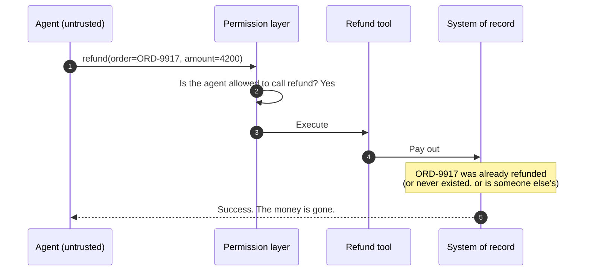
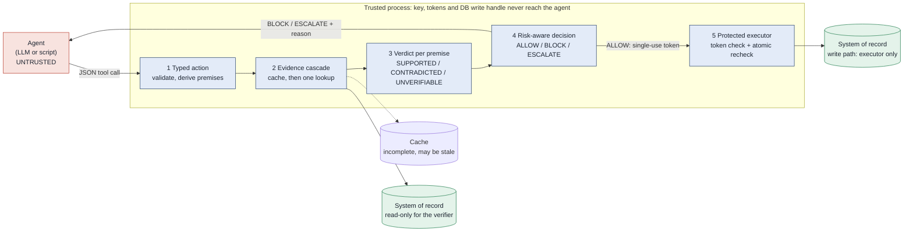
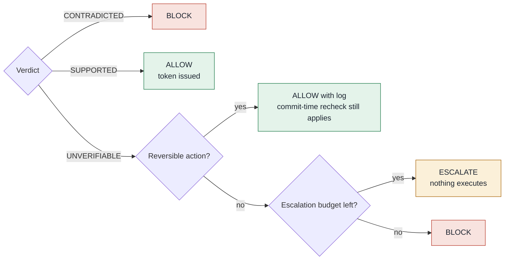
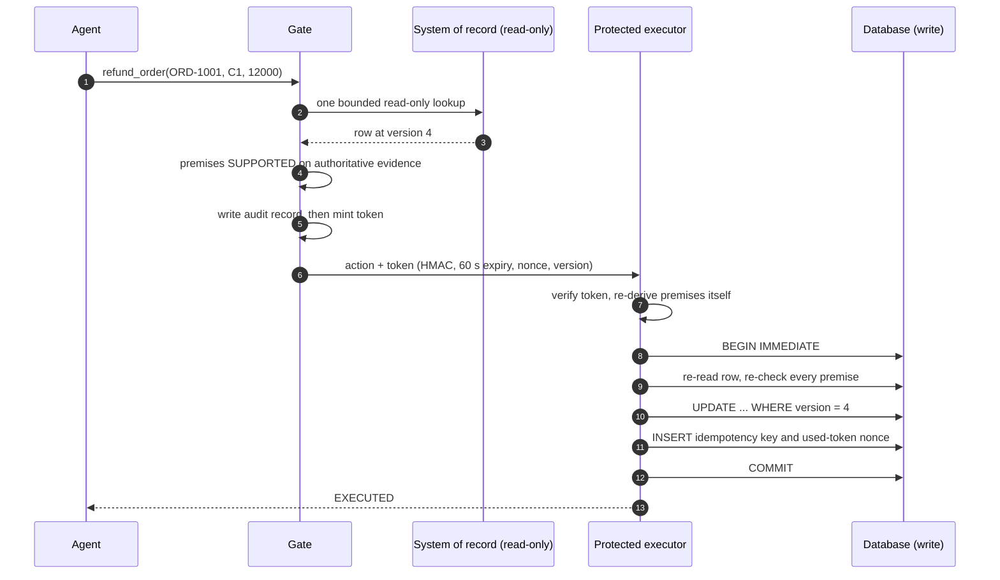
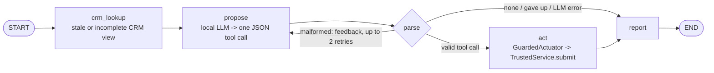
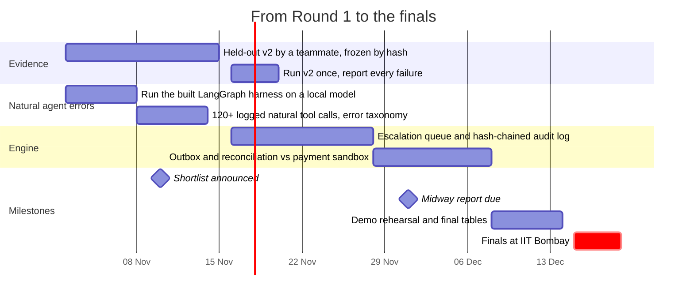

<div align="center">

# GroundGate

### Check an agent's facts before it acts, and make the database itself refuse the action if the facts changed.

**Perceptron Hackathon 2026** · IITB × Optiver AI Innovation Lab · Techfest, IIT Bombay · Theme 6, Problem 9: *Catching an Agent Before It Acts on a Bad Idea*

     

[**Try the playground**](docs/index.html) · [Architecture and flows](docs/ARCHITECTURE.md) · [Results](#results) · [Run it](#run-it) · [Agent harness](#langgraph-agent-harness) · [Honest limits](#what-is-not-done) · [Roadmap](#roadmap)


</div>

> **No install needed to explore:** open [`docs/index.html`](docs/index.html) (or enable GitHub Pages on `/docs`). It replays 246 scenarios recorded from the real gate and executor. Pick an agent request, corrupt the evidence, and watch each stage decide.

---

## At a glance

| | |
|---|---|
| **The idea** | Most guardrails ask *"may the agent do this?"* GroundGate asks *"is what the agent believes true?"* and enforces the answer at the write. |
| **How** | Typed action → evidence cascade (cache, then one bounded lookup) → three-valued verdicts → risk-aware decision → protected executor that rechecks inside the transaction. |
| **Stack** | Python standard library · SQLite system of record · optional LangGraph agent with a local model |
| **Held-out v1** (51 cases, frozen by hash before its first run) | GroundGate executed **0 of 31** harmful actions and completed **18 of 20** valid ones |
| **Where it is weak** | A fresh-but-wrong cache lets a *low-value* action past the gate (the executor stops it). Valid-but-unintended actions execute. Evidence is synthetic; no natural model errors measured yet. |
| **Tests** | 120 automated tests, about 10 s |

## The problem

An agent calls `refund_order(ORD-1001, C1, 12000)`. The call is well-formed. The agent has permission. The code will run it. And it is still wrong, because the order doesn't exist, belongs to someone else, or was already refunded. Permission checks and schema validation never look at that.



Checking the fact sounds easy: look it up. The difficulty is everything around the lookup:

| Real-world condition | The tempting mistake | What GroundGate does |
|---|---|---|
| The cache has no entry for the order | treat "not in cache" as "doesn't exist" and block valid work | `UNVERIFIABLE`, never `CONTRADICTED` |
| The cache has an entry, but it is old | trust it | a stale entry supports nothing |
| The authoritative source times out | treat "couldn't check" as "checked, fine" | irreversible actions escalate; nothing runs on an unanswered question |
| Every lookup costs time and money | always query, whatever the stakes | one bounded lookup, routed by risk tier |
| The order changes after the check, before the write | assume the check still holds | the executor rechecks **inside** the write transaction |

## How it works



1. **Typed action.** Each tool (`refund_order`, `cancel_order`, `update_address`) has a schema. The gate validates arguments and derives the *premises* itself, from the schema and not from the agent's explanation. A refund rests on four: the order exists, it belongs to this customer, its status allows a refund, and the amount fits what's left.
2. **Evidence cascade.** Cache first. At most one read-only lookup of the system of record, and only when the action's risk calls for it. Authoritative evidence outranks cache; disagreements are logged.
3. **Three-valued verdicts.** `SUPPORTED`, `CONTRADICTED` or `UNVERIFIABLE`. Missing or stale evidence is `UNVERIFIABLE`, never `CONTRADICTED`.
4. **Risk-aware decision.** The verdict and the risk tier decide the outcome (below).
5. **Protected executor.** The only code that can write. It needs a single-use, expiring, action-bound token, re-derives the premises itself, and rechecks them in one transaction.

> **Deep dive:** [`docs/ARCHITECTURE.md`](docs/ARCHITECTURE.md) has 16 diagrams: trust boundaries, component map, request lifecycle, evidence cascade, breaker state machine, token anatomy, executor check order, data model, every failure flow, LangGraph integration and the evaluation pipeline.

### From verdict to decision



**Risk tiers.** An irreversible action at or above `HIGH_AMOUNT_CENTS` (5000 in `model.py`; the benchmark freezes 2500 on its dev seeds) is *high risk* and needs authoritative support. Cancel has no amount, so it is always high. Reversible or small actions may rest on a fresh cache. The costs behind the policy (harm 50, false block 1, escalation 5, lookup 0.1) are assumptions.

### The execution barrier



<details><summary><b>What happens when things go wrong</b></summary>

| # | Situation | What happens | Result | Evidence in the repo |
|---|---|---|---|---|
| 1 | **Evidence is stale** | A stale cache entry can't support any premise. The gate falls through to the authoritative lookup. A high-risk action never rests on cache at all. | If the source agrees: allowed. If not: blocked. | `test06_stale_cache_not_trusted`, red-team X07 |
| 2 | **Authoritative source times out** | Premises stay `UNVERIFIABLE`. Irreversible action → `ESCALATE` (or `BLOCK` once the escalation budget is spent). Reversible action → allowed *with a log*, and the executor still rechecks. The breaker opens after 3 faults. | Nothing irreversible runs on an unanswered question. | `test09`, `test10`, `test10b`, red-team X10, X11 |
| 3 | **The record changes after verification** | The executor re-reads the row **inside** `BEGIN IMMEDIATE`, re-evaluates every premise, and uses a version-conditional `UPDATE`. Optional `strict_version` also aborts if the version moved. | `ABORTED_PRECONDITION`, nothing written. | `test16b_stale_cache_low_risk_caught_at_commit`, scenarios D01–D02, X09, X17, X18 |
| 4 | **An action token is reused** | The token is an HMAC over action, decision, expiry, nonce and row version. Changed arguments break the HMAC; expiry is 60 s; the nonce goes into `used_tokens` in the same transaction. Retrying the same action returns `DUPLICATE`; reusing a request id for a different action returns `IDEMPOTENCY_CONFLICT`. | `TOKEN_REPLAYED`, `DUPLICATE` or a bypass error. Never a second write. | `test_token_nonce_single_use_even_if_idempotency_row_lost`, X12–X16 |
| 5 | **An external API succeeds but the local system fails to record it** | See below. | Not solved by the database. | `benchmarks/external_effects.py` (simulation only) |

### Case 5, stated plainly

A local SQLite transaction **cannot** be atomic with a call to an external payment API. If the API charges the refund and the process dies before the local `COMMIT`, the two systems disagree, and no amount of local locking fixes that. The executor in this repo writes only to SQLite, so it does not face this problem today; the simulation in `external_effects.py` does.

| Mitigation | Status |
|---|---|
| Send an idempotency key with every external call, so a retry can't charge twice | **Simulated.** Blind retry duplicates 8.4% of refunds under ambiguous timeouts; idempotency keys bring it to 0.0% *when the processor honours them*. A client that sends keys to a processor that ignores them still duplicates 8.4%. |
| Reconcile by querying the processor's ledger before any retry | **Simulated.** 0.0% duplicates, including for processors without idempotency keys. |
| Write an *intent* row (outbox) before the call, then record the result after, so a crash leaves evidence to reconcile from | **Planned** (milestone in the roadmap). Not in the executor yet. |
| Non-atomic recheck just before the external call | **Simulated.** Shrinks executed harm from 4.9% to 1.6% (and 0.3% with a tighter window), never to 0.0%. |

Idempotency keys and reconciliation are standard payment-engineering practice. We use them; we don't claim them.
</details>

## Results

Everything here is synthetic or scenario-based; none of it is from a live system. Intervals are 95% Wilson.

### Held-out scenarios v1 (51 cases: 31 harmful, 20 valid), frozen before the first run

Same runner, same labels-first rule, same gate and thresholds as on dev. The set was written without opening `src/`, was frozen by SHA-256, run once, and nothing was changed afterwards.

| Arm | Harmful executed | 95% CI | Valid completed | 95% CI |
|---|---|---|---|---|
| no guard | 27/31 (87%) | [71, 95] | 20/20 | [84, 100] |
| closed-world cache | 6/31 (19%) | [9, 36] | 2/20 (10%) | [3, 30] |
| always query | 6/31 (19%) | [9, 36] | 17/20 (85%) | [64, 95] |
| **GroundGate** | **0/31 (0%)** | [0, 11] | 18/20 (90%) | [70, 97] |

* **8 of 31 harmful cases passed the gate** and were stopped only by the executor's commit-time recheck: six changed-after-check cases (`H044`–`H047`, `H050`, `H051`) and two fresh-but-wrong cache entries (`H032`, `H041`, both low-value refunds). This is the same known gate-level hole as on dev, and it reproduced on cases the gate was not tuned on.
* **Always-query executes 6 harmful cases** for the same six changed-after-check reasons: it has no commit-time check.
* **GroundGate's two valid misses** are `H037` and `H039`: source down, nothing cached, irreversible action, so it escalates. That is the designed cost of refusing to act on an unanswered question.
* A zero is not proof of safety: with 31 harmful cases the upper bound is 11%. Full tables and every failure: [`results/scenarios_heldout.md`](results/scenarios_heldout.md).

<details><summary><b>Realistic dev scenarios (30 cases: 17 harmful, 13 valid)</b></summary>

Labels fixed in the files; outcomes from database diffs. Cases were written on the implementer side, so this is a development check, not independent evidence.

| Arm | Harmful executed | 95% CI | Valid completed | 95% CI |
|---|---|---|---|---|
| no guard | 14/17 (82%) | [59, 94] | 13/13 | [77, 100] |
| closed-world cache | 3/17 (18%) | [6, 41] | 0/13 | [0, 23] |
| always query | 2/17 (12%) | [3, 34] | 11/13 (85%) | [58, 96] |
| **GroundGate** | **0/17 (0%)** | [0, 18] | 12/13 (92%) | [67, 99] |

GroundGate's *pre-commit* number is worse than its final one: **3 of 17 harmful cases passed the gate** and were stopped only by the executor's recheck (`D01`, `D02`, and `S03`, a fresh-but-wrong cache on a low-value refund). Always-query fails the same two changed-after-check cases because it has no commit-time check. The one valid case GroundGate doesn't complete is `S07`: source down, irreversible, nothing to verify against, so it escalates. Full table: [`results/scenarios_dev.md`](results/scenarios_dev.md).
</details>

### Synthetic benchmark and external-effects model

20 independent worlds × 500 actions × 8 evidence conditions (cache completeness, staleness, replica lag, outage, lookup budget, drift), dev and test split.

| Question | Result |
|---|---|
| Executed harm when the record changes between check and call (external API, no atomic recheck) | no guard **42.5%** → GroundGate **4.9%** → + non-atomic recheck **1.6%** → tighter window **0.3%** → atomic recheck **0.0%** |
| Who gets the credit? | The recheck. Always-query + the same recheck also reaches 1.6%. This benefit is not specific to GroundGate. |
| Completion under a tight lookup budget (0.2 lookups/action, condition C5) | GroundGate completes **10.6** points more valid actions than always-query (95% CI 9.8 to 11.4), with harmful passes falling from 19.5% to 10.3% |
| Where GroundGate loses | in the external model (no atomic recheck) a *fresh-but-wrong* cache lets it execute 2.5% of harmful actions where always-query executes 0.0%; at a 0.2 lookup budget there it completes 48.2% of valid actions against 60.0%, escalating 48.6% instead |
| Closed-world cache guard | reaches 0% harm but completes only about 60% of valid actions |
| A learned alternative | a VOI-style policy fitted on dev data beats our hand-set tiers on expected loss at our assumed costs. We kept the transparent tiers and report the alternative. |
| An online reliability estimator | cuts harm but costs 5 to 22 points of valid completions at cold start. Not shipped. |
| Blind retries after ambiguous timeouts | 8.4% duplicate refunds; 0.0% with idempotency keys or reconciliation |
| Race stress, 4 processes × 4 threads, 30 runs | executor: 0 of 30 runs with a violation (Wilson upper bound 11.4%). Naive writer: 30 of 30 runs, about 15 over-refunded orders per run. |
| Red team | 73 builder cases + 37 extended cases, all stopped; 3 documented limits. **Not independent.** |

Tables and CIs: [`docs/RESULTS.md`](docs/RESULTS.md), [`results/benchmark.md`](results/benchmark.md), [`results/external/EXTERNAL_RESULTS.md`](results/external/EXTERNAL_RESULTS.md).

## LangGraph agent harness

> **Status: built and tested, not yet run on a real model.** The tests use a scripted stand-in and a fake HTTP endpoint. No natural-error number exists until you run it on a local model. The offline `--llm demo` output is labelled SMOKE because its faults are injected.



* The agent never sees the system of record, only a CRM view that can be stale or missing orders. The `act` node holds only the JSON channel to the trusted child process.
* 40 tickets (20 where the right move is *no action*), intents fixed before any run, labels derived from the **database truth**, never from a guard.
* **Paired design:** each model proposal is judged four ways on identical state. GroundGate is the live path; no-guard, closed-world cache and always-query replay the same recorded proposal. The report adds a mistake taxonomy, a per-ticket view (runs of one ticket aren't independent), and SHA-256 of tickets and prompt.
* Works with any OpenAI-compatible server: **Ollama**, llama.cpp, vLLM.

```bash
pip install -e .[agent]                      # adds langgraph only
ollama pull qwen2.5:7b-instruct
python3 agent/run_natural.py --model qwen2.5:7b-instruct --runs 3     # writes results/natural_agent/
```
Details and honesty rules: [`agent/README.md`](agent/README.md).

## Evaluation design

Most of our numbers come from synthetic worlds, and we say so. The design is meant to make that evidence hard to fool ourselves with.

### Three evidence layers

| Layer | What it is | Who wrote it | Status |
|---|---|---|---|
| **Synthetic benchmark** | 20 worlds × 500 actions, 8 evidence conditions | us, with dev and test split | run, CIs reported |
| **Realistic scenario sets** | refunds, cancellations, wrong customer ids, already-completed refunds, stale info, changes after the check ([`scenarios/`](scenarios/README.md)) | **dev** (30): implementer. **Held-out v1** (51): written without opening `src/`, AI-assisted, frozen by hash. **v2**: a teammate, **kit built, no cases written yet** | dev and v1: run. v1 run once, reported above |
| **Natural agent errors** | a local open-weight model calling the tools through LangGraph | the model | **harness built; real-model run not yet executed** |

### Avoiding circular evaluation

If the commit-time recheck decides what counts as safe, every arm that includes it looks perfect by definition. So:

1. **Labels are inputs.** Authors write `valid` or `harmful` before any arm runs; no guard produces a label.
2. **Outcomes come from the database.** "Executed" means the order row changed between a snapshot and the end of the call. Return values are ignored.
3. **Gate and executor are reported apart.** *Harmful passed the gate* sits next to *harmful executed*. The gap is what an in-transaction recheck buys, and we don't credit it to GroundGate's routing.
4. **Independent recomputation.** `benchmarks/verify_results.py` recomputes every summary cell from raw rows without importing the benchmark's metric code (1,440 raw rows, 1,200 cells, 0 discrepancies).
5. **Held-out sets are frozen by SHA-256** and the runner refuses to run if they changed.

<details><summary><b>Baselines, and the four state views</b></summary>

| Baseline | What it represents |
|---|---|
| **no guard** | the agent's call executes as proposed |
| **closed-world cache** | "not in cache means doesn't exist" |
| **always query** | one authoritative lookup for every action, no routing |
| **VOI-style budgeted re-verification** | our reimplementation, fitted on dev data (not the original authors' code) |
| **executor-only recheck** | no pre-check; only the in-transaction recheck |
| **fact gate** | a NOMOS-style deterministic rule gate, our reimplementation |


S0 what the agent saw · R what the verifier could see · S1 the truth at verification · S2 the truth at mutation. Harm is labelled from S2 only.
</details>

## How GroundGate differs from existing work

| Existing approach | What it checks | GroundGate's distinction |
|---|---|---|
| **Permission-based guardrails** ([Progent](https://arxiv.org/abs/2504.11703), [AgentSpec](https://arxiv.org/abs/2503.18666)) | whether this agent may call this tool, under policy | checks the **factual premises** behind an allowed call |
| **Policy compilation** ([NOMOS](https://arxiv.org/abs/2610.11030)) | compiles written policy into a deterministic tool-call gate | the gate's rules come from tool *schemas and the live record*; it tests what an incomplete or stale source can and can't prove |
| **Cache-based verification** (closed-world baseline) | trusts the cache | a **missing entry is inconclusive**, never proof of absence; stale evidence can't support an irreversible action |
| **Pre-action verification** ([Look Before You Leap](https://arxiv.org/abs/2609.12057)) | verifies a proposed action before it runs | adds **mutation-time revalidation** in the executor |
| **Always-query systems** | query the source every time | spends a **bounded lookup budget** by risk tier, and measures the completion cost |
| **Evidence-grounding benchmarks** ([EnvTrustBench](https://arxiv.org/abs/2605.08828)) | measure whether agents verify environment claims | a *defence* that is itself evaluated under degraded evidence |
| **Memory-premise verification** ([AMV-Guard](https://arxiv.org/abs/2610.31446)) | which memory premises to re-verify per action, trading risk, abstention and cost | **closest neighbour.** We add the commit-time barrier and the external-effects analysis; they work on long-lived memory |

**What we claim, and what we don't.** GroundGate's contribution is not another permission layer. It is a study of how *evidence quality, freshness, lookup budgets and state changes* affect both safety and completion of business actions, plus a small implementation that makes the write path enforce the result. We do **not** claim every mechanism is new: typed preconditions, HMAC tokens, idempotency keys and transactional rechecks are established practice, and our own results show most late-change protection comes from the recheck. The novelty is the combination, the framing and the evaluation: separating what the gate prevents from what the executor prevents, and keeping the results where GroundGate loses.

*Basis:* abstracts read on 1 November 2026; a full read-through of each is on our list. Also cited in the Round 1 submission and not re-checked in this update: CaMeL (2503.18813), Reddy et al. (2607.07405), LedgerAgent (2606.20529), Zwerdling et al. (2507.16459), SafeCommit (2608.04289).

## What is not done

<details open><summary><b>Honest limits</b></summary>

* **Synthetic evidence.** Worlds, error rates and the loss costs are assumed. Latency is modelled (1 ms cache, 40 ms lookup), not measured.
* **No natural agent errors measured yet.** The LangGraph agent, the OpenAI-compatible client and the 40-ticket paired runner are built and tested, but only with a *scripted* stand-in. No model weights were reachable where this was built, so the real-model run is the next step and no error rate from it is claimed. `benchmarks/agent_harness.py` is the older scripted stub.
* **Held-out v1 is pre-registered, not independent.** Frozen before its first run and written without opening `src/`, but by the project itself with AI assistance, and its labels encode our business rules. The dev set and red-team suites were written with the code in view, so they are regression coverage, not validation. The v2 kit (`scenarios/validate_scenarios.py`, [`docs/TEAMMATE_V2_BRIEF.md`](docs/TEAMMATE_V2_BRIEF.md)) is ready, but until a teammate who has not read `src/` writes and freezes `heldout_v2`, nothing here is independent.
* **External effects are simulated.** No real payment sandbox is connected. The outbox/intent table is not built.
* **Known gate-level holes** (all caught by the executor, not the gate): a fresh-but-wrong cache entry passes a *low-value* action at the gate (`S03`, red-team X09); a valid but unintended action by the right customer executes (X38).
* **Not built:** an escalation consumer (today `ESCALATE` is a verdict, not a workflow), a tamper-evident audit log (it is append-only JSONL with fsync, not hash-chained), key rotation, and OS-level separation of the trusted process (a same-user attacker is out of scope; see [`docs/THREAT_MODEL.md`](docs/THREAT_MODEL.md)).
* **One domain.** Order operations. No claim about other domains.
</details>

## Run it

```bash
git clone https://github.com/DharmiSapariya/GroundGate && cd GroundGate
python3 -m unittest discover -s tests -t .        # 120 automated tests, about 10 s (graph tests skip if langgraph is absent)
```
```bash
python3 benchmarks/demo.py                         # unguarded vs guarded, in-process and process-isolated
python3 scenarios/run_scenarios.py --split dev     # 30 dev scenarios, 4 arms, CIs and failures
python3 scenarios/run_scenarios.py --split heldout # 51 frozen held-out scenarios (refuses to run if files changed)
python3 redteam/redteam_extended.py                # 37 extended attack cases
python3 redteam/redteam_builder.py                 # 73 builder attack cases
python3 benchmarks/external_effects.py             # external-API model: late changes, ambiguous timeouts
python3 benchmarks/agent_harness.py                # older scripted agent stub (no LLM)
python3 benchmarks/verify_results.py               # independent recomputation of the benchmark tables
python3 tools/make_playground_data.py              # rebuild docs/index.html from the real gate
python3 scenarios/validate_scenarios.py scenarios/heldout/heldout_v1.json --split heldout   # protocol check for any held-out file
python3 agent/run_natural.py --llm demo --runs 1   # LangGraph pipeline smoke test with a SCRIPTED stand-in (needs langgraph; not a model)
python3 agent/run_natural.py --model qwen2.5:7b-instruct --runs 3   # the real run: Ollama on localhost:11434, writes results/natural_agent/
```
The full benchmark (`python3 benchmarks/benchmark.py`, then `python3 benchmarks/report.py`) takes about four minutes. Python 3.10+; the core needs nothing installed. The agent needs `pip install -e .[agent]` (adds `langgraph`) and a local OpenAI-compatible server such as Ollama; see [`agent/README.md`](agent/README.md).

<details><summary><b>What the demo prints</b></summary>

```
=== WITHOUT GUARD (agent calls the mutation directly) ===
valid refund               -> rows changed: 1
fabricated order ID        -> rows changed: 0
real ID, other customer    -> rows changed: 1      <- wrong-customer refund executed

=== WITH GROUNDGATE (in-process) ===
valid refund               -> ALLOW    verdict=SUPPORTED     exec=EXECUTED
fabricated order ID        -> BLOCK    verdict=CONTRADICTED  exec=not executed
real ID, other customer    -> BLOCK    verdict=CONTRADICTED  exec=not executed
Direct bypass attempt (no token): GateBypassError: mutation requires a valid ALLOW token from the gate

=== PROCESS-ISOLATED SERVICE ===
forged token + stripped premises + fake ALLOW  -> BLOCK (premise contradicted)
re-submit after the order is fully refunded    -> BLOCK (premise contradicted)
garbage bytes / pickle payload                  -> BLOCK
```
</details>

### Use it from an agent

```python
from groundgate.service import TrustedService

svc = TrustedService("orders.db", audit_path="audit.jsonl", actor="C1").start()
print(svc.submit("refund_order", {"order_id": "ORD-1001", "customer_id": "C1", "amount_cents": 12000}, "req-42"))
# {'decision': 'ALLOW', 'verdict': 'SUPPORTED', 'status': 'EXECUTED', ...}
svc.stop()
```
The agent side sees only JSON. The HMAC key, tokens and the write connection live in the child process. In `agent/graph.py` the LangGraph `act` node is exactly that call, and a failed model call, a malformed reply or an unreachable service all end without an action.

## Repo map

```
src/groundgate/     gate.py (cascade, policy, tokens, executor) · model.py (typed actions, premises)
                    sources.py (cache, read-only source, breaker) · service.py (process-isolated service)
agent/              LangGraph agent, OpenAI-compatible client, 40 tickets, paired natural-error runner (optional extra)
scenarios/          30 dev cases, 51 frozen held-out cases (+ FROZEN.sha256), runner, validator, heldout_v2/ kit
benchmarks/         synthetic benchmark, external-effects model, concurrency stress, demo, agent stub
redteam/            73 builder + 37 extended attack cases
tests/              120 tests (core, security, boundary, service, scenarios, agent, v2 kit, docs consistency)
results/            every number quoted here, as JSON and Markdown
docs/               ARCHITECTURE · THREAT_MODEL · ALGORITHM_DESIGN · EVALUATION_PROTOCOL · RESULTS · TEAMMATE_V2_BRIEF · index.html (playground)
docs/assets/        architecture and evaluation diagrams (PNG)
submission/         abstract PDF and its source
```

| Doc | What is in it |
|---|---|
| [`docs/ARCHITECTURE.md`](docs/ARCHITECTURE.md) | all diagrams and flows, component map, failure paths |
| [`docs/THREAT_MODEL.md`](docs/THREAT_MODEL.md) | assets, attackers, what is in and out of scope |
| [`docs/ALGORITHM_DESIGN.md`](docs/ALGORITHM_DESIGN.md) | cascade, policy and costs in detail |
| [`docs/EVALUATION_PROTOCOL.md`](docs/EVALUATION_PROTOCOL.md) | evaluation rules, incl. the real-model protocol |
| [`docs/RESULTS.md`](docs/RESULTS.md) | benchmark tables and intervals |
| [`scenarios/README.md`](scenarios/README.md) | scenario format, authoring protocol, v2 workflow |
| [`agent/README.md`](agent/README.md) | running the LangGraph agent on a local model |

## Hackathon mapping

| Problem 9 asks for | Where it lives |
|---|---|
| A checker that verifies at least one class of agent action against a source before execution | refund, cancel and address calls checked against the SQLite system of record |
| Catching a deliberately bad or hallucinated action | fabricated order ids, other customers' orders, already-refunded orders, forged tokens and hostile payloads are blocked while valid actions pass (`benchmarks/demo.py`, the playground, 110 attack cases) |
| *Stretch:* route between fast and careful checks by risk | risk-tier routing (cache-only, one lookup, or escalate) is built and evaluated; an optional LLM tier hook exists that can only downgrade a verdict, off by default and not evaluated |
| *Stretch:* a small red-team suite | 110 attack cases (73 builder + 37 extended), not independent |

## Roadmap



If time runs short, the outbox goes first; the agent run and held-out v2 stay, because those are the evidence a reviewer asks about.

| What is built today | Planned for the finals |
|---|---|
| gate, evidence cascade, tokens, protected executor | escalation queue consumer; hash-chained audit log |
| 30 dev + 51 frozen held-out scenarios, 110 attack cases, v2 kit | **held-out v2 written by a teammate**, to make the evidence independent |
| LangGraph agent, local-model client, 40-ticket paired runner (scripted-model tested) | **run on a local open-weight model**: 40 tickets × 3 runs = 120 logged calls per model |
| external-API *simulation* (retries, late changes) | **outbox/intent table plus reconciliation against a payment-processor sandbox or mock ledger** |

## Team

**Team Neural Genesis** · Techfest ID `TM-1EFBCA97D27`

| Member | Technical skills | Owns |
|---|---|---|
| **Dharmi Sandip Sapariya** | DBMS, applied statistics, machine learning | **verification engine and protected executor** (`src/`), transaction and idempotency logic, bootstrap and Wilson statistics, red-team and unit tests |
| **Mouktika Jakkam** (team leader) | Python, LLM-agent tooling (LangGraph, local open-weight models), scenario design, technical writing | **agent integration** (through the JSON service only), **held-out v2 scenarios** (a teammate who never opens `src/`), documentation and demo |

## References

Checked against their arXiv pages on 1 November 2026.

1. *When Is a Memory Safe Enough to Act On? Action-Conditioned Verification for Long-Lived Agents* (AMV-Guard). [arXiv:2610.31446](https://arxiv.org/abs/2610.31446)
2. *NOMOS: Compiling Written Policies into Statically Verified Tool-Call Gates for LLM Agents.* [arXiv:2610.11030](https://arxiv.org/abs/2610.11030)
3. *Look Before You Leap: Pre-Action Verification for LLM Agents.* [arXiv:2609.12057](https://arxiv.org/abs/2609.12057)
4. *When Agents Overtrust Environmental Evidence* (EnvTrustBench). [arXiv:2605.08828](https://arxiv.org/abs/2605.08828)
5. *Progent: Programmable Privilege Control for LLM Agents.* [arXiv:2504.11703](https://arxiv.org/abs/2504.11703)
6. *AgentSpec: Customizable Runtime Enforcement for Safe and Reliable LLM Agents.* [arXiv:2503.18666](https://arxiv.org/abs/2503.18666)

<div align="center"><sub>All benchmark numbers in this repository come from synthetic worlds or hand-written scenarios. Real-model results will be reported separately, whatever they show.</sub></div>
